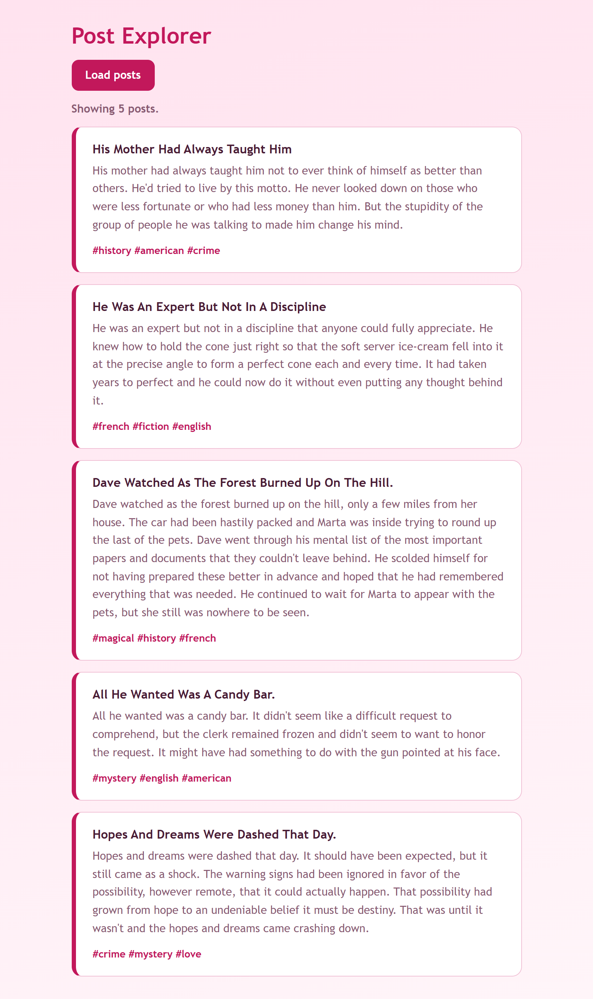
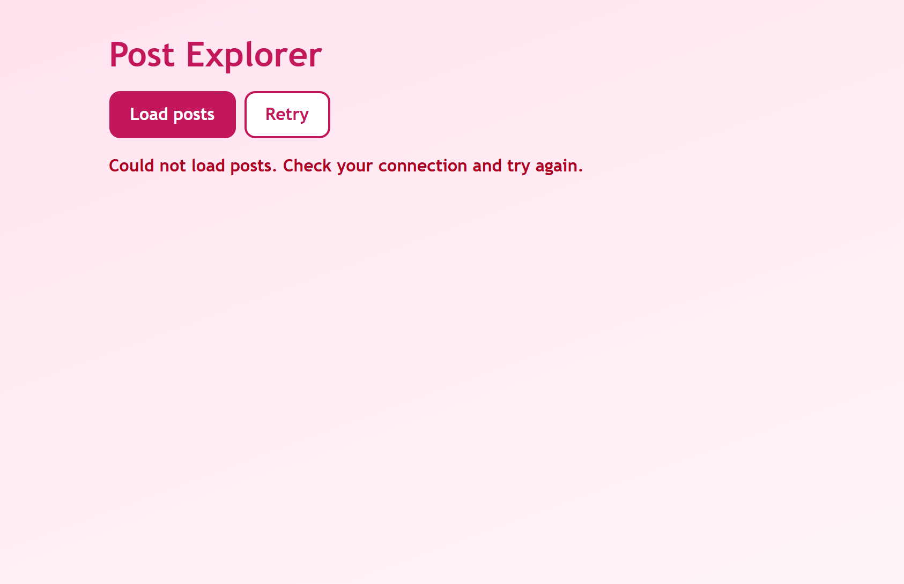

# Activity 7: Dynamic Post Explorer

A page that loads blog posts from the [DummyJSON](https://dummyjson.com/docs/posts) API without refreshing, using `fetch()` with `async/await`.

## Features

- Loads posts only when the **Load posts** button is clicked
- Uses `async/await` with `try / catch / finally`
- Shows only the first 5 posts (`data.posts.slice(0, 5)`)
- Renders the title and body with `textContent`, so data is never treated as HTML (XSS-safe)
- Shows a loading message and disables the button while the request runs
- Checks `response.ok` and shows an error message on failure
- Shows a **Retry** button after a failure
- Shows an empty-state message if the API returns no posts
- Updates the page without a refresh

## Files

| File | Purpose |
| --- | --- |
| `index.html` | Button, status message, and post list |
| `script.js` | Fetch logic, rendering, and state handling |
| `style.css` | Pink theme and card styling |

## How to run

1. Open the folder in VS Code.
2. Right-click `index.html` and choose **Open with Live Server** (install the Live Server extension if needed).
3. Click **Load posts**.

## Testing

| Test | How | Expected result |
| --- | --- | --- |
| Normal click | Click Load posts | 5 posts appear |
| Repeated clicks | Click quickly several times | Button disables while loading |
| Throttling | DevTools, Network tab, set "Slow 3G" | "Loading posts..." stays visible during the delay |
| Offline | DevTools, Network tab, set "Offline" | Error message and Retry button appear |
| Empty array | Temporarily set `API_URL` to `https://dummyjson.com/posts/search?q=zzzzzz` | "No posts found." |

## About the API

The lesson suggests JSONPlaceholder, but its posts are Latin filler text. This project uses DummyJSON instead, which returns readable English posts in a `{ posts: [...] }` object. The fetch, error handling, and rendering logic work the same way.

## Screenshots

Success state:

Error state:

## Author

Elaine Viloria